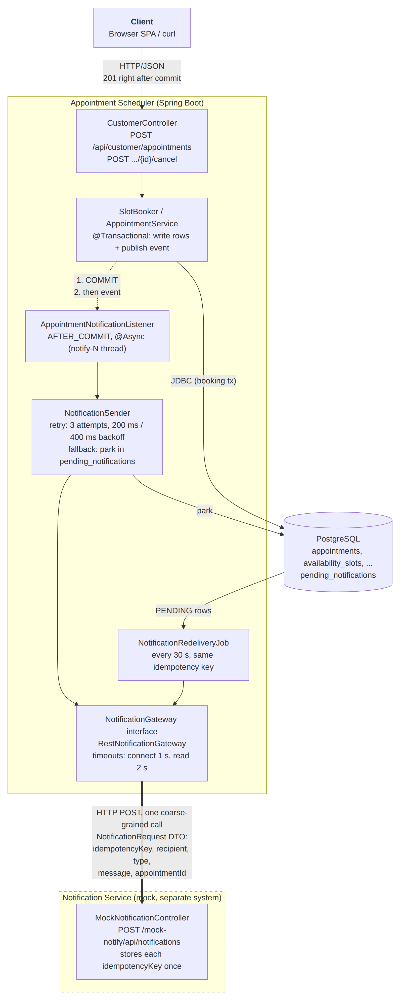

# Interview Scheduler

CMPE 172 term project: an **Online Appointment Scheduling System** where software engineers book
**resume reviews and mock interviews** (coding, system design, behavioral) with experienced mentors.

- **Customer**: a job-seeking engineer who browses and books sessions
- **Provider**: a mentor/interviewer who publishes availability

Stack: **Java 21, Spring Boot 3.5, PostgreSQL 16, plain JDBC (`JdbcClient`) with hand-written SQL. No ORM.**

> Note: `hibernate-validator` appears in the dependency tree. It is the Bean Validation (`@NotNull`, `@Size`)
> implementation pulled in by `spring-boot-starter-validation`, **not** Hibernate ORM. There is no JPA/Hibernate ORM on the classpath.

## What's implemented

Layered design: **Controller → Service → Repository (JDBC, hand-written SQL) → PostgreSQL**. Controllers return
DTOs, never raw rows. The frontend is a Bootstrap 5 single-page app (`static/index.html` + `app.js`) that calls the
JSON API below with `fetch()`.

### Milestone 3: distribution boundary, observability, delivery



**Client → Appointment Scheduler → Notification Service.** Booking and cancelling send a confirmation to a
**mock notification service** (`mocknotify/MockNotificationController`, `/mock-notify/**`). It is a second Spring
controller in this project, but it is treated as a separate system: the scheduler reaches it only over HTTP
through a Gateway, and the two sides share no Java classes, only the JSON shape.

- **Coarse-grained interface:** `NotificationGateway.send(NotificationRequest)` is one remote call carrying one
  DTO `{idempotencyKey, recipient, type, message, appointmentId}`. The finished message travels with the call, so
  the service never calls back into the scheduler. `RestNotificationGateway` is the HTTP implementation; a real
  channel (Slack/Discord webhook, SMTP) would be another implementation of the same interface.
- **Commit, then notify:** `SlotBooker.bookOnce` and `AppointmentService.cancel` publish an
  `AppointmentChangedEvent` inside their transaction. `AppointmentNotificationListener` is
  `@TransactionalEventListener(AFTER_COMMIT)` + `@Async`: it runs only if the transaction committed, on a
  background thread (`notify-N`). The HTTP response does not wait for the notification service. A booking attempt
  that loses a race rolls back, so its event is dropped and a retried booking sends exactly one confirmation.
- **Timeout:** connect 1 s, read 2 s (`notification.connect-timeout`, `notification.read-timeout`).
- **Retry:** `NotificationSender` tries 3 times with exponential backoff (200 ms, 400 ms) on timeouts, refused
  connections and 5xx answers. A 4xx answer is not retried (resending the same request cannot fix it).
- **Fallback:** if every attempt fails, the notification is stored in `pending_notifications` (status `PENDING`;
  `FAILED` for a 4xx). `NotificationRedeliveryJob` re-sends PENDING rows every 30 s. After 10 total attempts, the
  row becomes `FAILED`.
- **Idempotent retries:** each notification has a fixed key `appointment-{id}-{BOOKING_CONFIRMED|BOOKING_CANCELLED}`,
  sent in the body and as an `Idempotency-Key` header. The mock stores each key once and answers `DUPLICATE` for a
  repeat. Case covered: a timed-out call that did reach the service, followed by a retry.

Mock service endpoints (demo only; disable with `mock-notify.enabled=false`):

| Method | Path | Description |
|---|---|---|
| POST | `/mock-notify/api/notifications` | Receive a notification. 201 ACCEPTED, 200 DUPLICATE, 503 when DOWN |
| GET | `/mock-notify/api/notifications` | Everything "sent" so far |
| GET / PUT | `/mock-notify/admin/mode?mode=UP\|SLOW\|DOWN&delayMs=5000` | Make the mock slow or fail |

**Observability**

| What | Where |
|---|---|
| `GET /health` | 200 `{"status":"UP","database":{"status":"UP","responseTimeMs":1},"notifications":{"status":"UP","pending":0,"failed":0}}`. Database check = `SELECT 1`. Database unreachable → **503** `"status":"DOWN"`. Parked notifications → `notifications.status: "DEGRADED"` while the app stays UP. Docker `HEALTHCHECK` calls it. |
| Metric `scheduler.booking` (timer) | Tag `outcome` = `booked` / `unavailable` / `conflict` / `rejected` / `error`. Gives bookings, failed bookings and average booking latency (`TOTAL_TIME / COUNT`). `GET /actuator/metrics/scheduler.booking?tag=outcome:booked` |
| Metric `scheduler.notifications` (counter) | Tags `result` = `sent` / `parked` / `redelivered` / `failed`, `type`. `GET /actuator/metrics/scheduler.notifications?tag=result:parked` |
| Logs | INFO `Customer jordan.dev booked slot 11 (appointment 3, attempt 1)`, `Sent BOOKING_CONFIRMED to jordan@example.com ...`, `Redelivered appointment-3-BOOKING_CONFIRMED ...`; WARN `Notification appointment-3-BOOKING_CONFIRMED attempt 1/3 failed: ... Retrying in 200 ms`, `Notification service unavailable after 3 attempt(s); parked ...`, `Booking failed: customer sam.dev slot 4: ...`; ERROR `Notification ... rejected, not retrying`, `Giving up on notification ...`, `Health check: database unreachable`, `Could not send or park ... notification` |

**Try the failure and recovery** (app running on :8080):

```bash
curl -X PUT 'localhost:8080/mock-notify/admin/mode?mode=DOWN'   # or SLOW&delayMs=5000
# book in the UI -> 201 right away; logs show 3 attempts, then "parked ... for redelivery"
curl localhost:8080/health                                       # notifications: DEGRADED, pending: 1
curl -X PUT 'localhost:8080/mock-notify/admin/mode?mode=UP'
# within 30 s: "Redelivered ..."; /health back to UP; GET /mock-notify/api/notifications shows it once
```

**Delivery:** `Dockerfile` (multi-stage, `HEALTHCHECK` on `/health`) and `docker-compose.yml` (app + PostgreSQL).
GitHub Actions (`.github/workflows/ci.yml`) runs `mvn -B verify` (all tests, PostgreSQL via Testcontainers),
uploads the test reports and builds the Docker image on every push.

**Tests:** `NotificationDownIntegrationTest` (booking and cancel succeed while the notification service is
unreachable; the notifications are parked; `/health` is DEGRADED), `NotificationIntegrationTest` (real HTTP on a
random port: one notification per book/cancel; slow service → timeout → parked → redelivered with no duplicate;
503 → parked → redelivered; `/health`; metric), `NotificationSenderTest` (retry/fallback rules).

### Milestone 2: booking, login, concurrency

- **Login + RBAC:** username/password checked against a BCrypt hash; the role is read from `users.role` over JDBC;
  a server-side HTTP session (cookie `JSESSIONID`) keeps you logged in. `/api/customer/**` is customer-only and
  `/api/provider/**` is provider-only. Not logged in → **401**, wrong role → **403**.
- **Customer:** browse/filter/paginate open slots, book a slot, see the confirmation, view upcoming/history,
  cancel own appointment (owner-only).
- **Provider:** add availability slots (each tied to a service; length = the service's duration), remove own
  open slots, view appointments booked with them.
- **Statuses:** BOOKED, CANCELLED, and COMPLETED (set for past appointments by a once-a-minute job).
- **Double-booking prevention:** see [Concurrency](#concurrency-and-transactions) below.
- **Errors:** JSON body `{timestamp, status, error, message, path}` with 400 / 401 / 403 / 404 / 409; never a stack trace.
- Design decisions for this milestone: [`DECISIONS.md`](DECISIONS.md).

### API

| Method | Path | Who | Description |
|---|---|---|---|
| GET | `/` | anyone | The web app |
| GET | `/api/home` | anyone | Services, providers, open-slot count |
| GET | `/api/slots` | anyone | Open future slots. Query: `providerId`, `serviceId`, `date` (YYYY-MM-DD), `page` (0-based), `size` (1–50). SQL `LIMIT/OFFSET` |
| GET | `/api/slots/{id}` | anyone | One open slot (404 if booked, removed or past) |
| GET | `/api/services`, `/api/providers` | anyone | Catalog |
| POST | `/api/auth/login` | anyone | Form fields `username`, `password`. 200 + user JSON, or 401 |
| POST | `/api/auth/logout` | logged in | 204 |
| GET | `/api/auth/me` | anyone | Current user, or 204 if not logged in |
| POST | `/api/customer/appointments` | CUSTOMER | Book. Body `{"slotId", "serviceId", "notes"}`. 201, or **409 if the slot was taken** |
| GET | `/api/customer/appointments?scope=upcoming\|history` | CUSTOMER | My appointments |
| POST | `/api/customer/appointments/{id}/cancel` | CUSTOMER (owner) | Cancel; the slot opens again |
| GET | `/api/provider/slots` | PROVIDER | My upcoming slots (OPEN and BOOKED) |
| POST | `/api/provider/slots` | PROVIDER | Body `{"serviceId", "startTime": "2026-11-02T10:00"}`. 201, 409 if it overlaps |
| DELETE | `/api/provider/slots/{id}` | PROVIDER (owner) | Remove an OPEN slot (soft delete). 204 |
| GET | `/api/provider/appointments?scope=upcoming\|history` | PROVIDER | Appointments booked with me |
| GET | `/health` | anyone | Health check with database check (503 if the database is down) |
| GET | `/actuator/health`, `/actuator/metrics/{name}` | anyone | Spring Actuator health and metrics |

Write requests need the CSRF token: send the `XSRF-TOKEN` cookie's value in an `X-XSRF-TOKEN` header
(`app.js` does this; see the curl example below).

### Concurrency and transactions

Two customers clicking **Book** on the same slot at the same moment must not both get it.

1. `SlotBooker.bookOnce()` runs in one `@Transactional(isolation = READ_COMMITTED)` transaction: read the slot
   (including its `version`), check the rules, then claim it with an **optimistic version check**:
   ```sql
   UPDATE availability_slots SET status = 'BOOKED', version = version + 1
    WHERE id = :id AND version = :version AND status = 'OPEN'
   ```
   and insert the appointment. 0 rows updated means another transaction got there first.
2. `BookingService.book()` retries a lost race up to 3 times, each in a **new** transaction. The retry re-reads
   the slot, sees it BOOKED, and returns **409 Conflict**.
3. Backstop in the database: `CREATE UNIQUE INDEX uq_appt_active_slot ON appointments (slot_id) WHERE status = 'BOOKED'`.

Proof: `ConcurrentBookingTest` starts two threads on the same slot behind a barrier (10 repetitions) and asserts
exactly one booking succeeds, the other gets `SlotUnavailableException` (409), and the database has exactly one
active appointment.

### Milestone 1

- `schema.sql` (5 tables + double-booking guard) and `seed.sql`, run on every startup. Both only add what is missing,
  so data survives restarts. Reset with `docker compose down -v`.
- Dockerfile, docker-compose.yml, GitHub Actions CI ([Actions](https://github.com/c-banh-mi/cmpe172-interview-scheduler/actions))

Design docs:
- ER diagram: [`docs/er-diagram.png`](docs/er-diagram.png) (Mermaid source: [`docs/er-diagram.mmd`](docs/er-diagram.mmd))
- Block diagram (Milestone 2: with the Spring Security layer): [`docs/block-diagram.png`](docs/block-diagram.png) (Mermaid source: [`docs/block-diagram.mmd`](docs/block-diagram.mmd))
- Booking sequence diagram (`POST /api/customer/appointments`, retry and 409 paths): [`docs/booking-sequence.png`](docs/booking-sequence.png) (Mermaid source: [`docs/booking-sequence.mmd`](docs/booking-sequence.mmd))
- Milestone 2 test results: [`docs/test-output.txt`](docs/test-output.txt); report snippets: [`docs/m2-report-material.md`](docs/m2-report-material.md); video order: [`docs/m2-video-cheatsheet.md`](docs/m2-video-cheatsheet.md)
- Relational schema: [`docs/relational-schema.md`](docs/relational-schema.md)
- Wireframes (Home, Available slots, Book appointment, Confirmation): [`docs/wireframes/`](docs/wireframes/) and [`docs/wireframes.pdf`](docs/wireframes.pdf)
- Milestone 1 report: [`docs/CMPE172_Milestone1_Report.pdf`](docs/CMPE172_Milestone1_Report.pdf)
- Milestone 2 report: [`docs/CMPE172_Milestone2_Report.pdf`](docs/CMPE172_Milestone2_Report.pdf)

## Prerequisites

- JDK 21, Maven 3.8+
- Docker (for PostgreSQL and for the integration tests)

## Setup

Create your local `.env` (gitignored; never commit it). Docker Compose needs it for both build and run:
```bash
cp .env.example .env    # then edit DB_PASSWORD
```

## Build

```bash
mvn -B package          # compile, run tests (needs Docker), produce target/interview-scheduler-*.jar
docker compose build    # build the app's Docker image (Maven runs inside the image; tests skipped)
```

## Run

**Option A: everything in Docker**
```bash
docker compose up --build
# open http://localhost:8080
```

**Option B: DB in Docker, app from Maven (for development)**
```bash
docker compose up -d db
export $(grep -v '^#' .env | xargs)   # load DB_USERNAME / DB_PASSWORD into the shell
mvn spring-boot:run
```

Data persists between restarts (Docker volume `pgdata`). To start over with fresh seed data:
`docker compose down -v`.

## Configuration

| Env var | Default |
|---|---|
| `DB_URL` | `jdbc:postgresql://localhost:5432/scheduler` |
| `DB_USERNAME` | `scheduler` |
| `DB_PASSWORD` | _none: set it in `.env`_ |
| `PORT` | `8080` |

Seeded accounts (password `password123`, stored as BCrypt): providers `alice.mentor`, `raj.mentor`,
`maria.mentor`; customers `sam.dev`, `jordan.dev`.

## Test

```bash
mvn test        # needs Docker running (Testcontainers starts PostgreSQL)
```

Without Docker, point the integration tests at any PostgreSQL you already run (its tables are emptied before
every test, so use a throwaway database):
```bash
mvn test -Dspring.profiles.active=localdb   # default: localhost:5433/scheduler_test, user/password scheduler_test
# override with TEST_DB_URL, TEST_DB_USERNAME, TEST_DB_PASSWORD
```

| Test | What it covers |
|---|---|
| `BookingServiceTest` | Booking rules, retry after a version conflict, role check (unit, mocks) |
| `AppointmentServiceTest` | Owner-only cancel, already-cancelled/started, upcoming vs history (unit) |
| `ProviderSlotServiceTest` | Slot length, overlap, ownership, booked slots can't be removed (unit) |
| `SlotServiceTest` | Paging math (unit) |
| `ConcurrentBookingTest` | **Two threads book the same slot; exactly one succeeds** (real PostgreSQL) |
| `BookingFlowIntegrationTest` | Book, 409, cancel, provider slots, COMPLETED, over HTTP |
| `AuthIntegrationTest` | Login/logout, BCrypt, 401 vs 403, CSRF |
| `ApiIntegrationTest` | Public browse/filter/paginate endpoints |

## Try it

Open http://localhost:8080, click **Browse Slots → Book**, and log in as `sam.dev` / `password123`.
Log in as `alice.mentor` to add or remove slots.

From the command line (the cookie jar holds the session and the CSRF cookie):
```bash
curl http://localhost:8080/api/home
curl "http://localhost:8080/api/slots?page=0&size=5"
curl "http://localhost:8080/api/slots?serviceId=1&date=$(date -d tomorrow +%F)"

curl -s -c jar -b jar http://localhost:8080/api/auth/me                    # get the XSRF-TOKEN cookie
xsrf() { awk '/XSRF-TOKEN/ {print $7}' jar; }
curl -s -c jar -b jar -H "X-XSRF-TOKEN: $(xsrf)" \
     -d username=sam.dev -d password=password123 http://localhost:8080/api/auth/login
curl -s -c jar -b jar -H "X-XSRF-TOKEN: $(xsrf)" -H 'Content-Type: application/json' \
     -d '{"slotId": 1, "serviceId": 2, "notes": "backend roles"}' http://localhost:8080/api/customer/appointments
curl -s -b jar "http://localhost:8080/api/customer/appointments?scope=upcoming"
```

## Code walkthrough video

- Milestone 1: https://drive.google.com/file/d/1bjLsSmwjBthYJkkrbdtsvMnHgxPHTZpi/view?usp=sharing
- Milestone 2: https://drive.google.com/file/d/10eYO288ZeQLtlxiJdYc3K5R9Ii3TWqV-/view?usp=sharing
